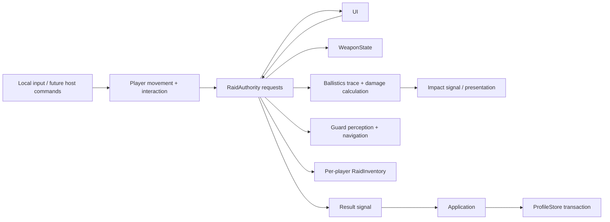

# Framework boundaries

`scenes/main.tscn` owns persistent profile/settings services, the UI, and a disposable `RaidAuthority` yard instance. Deployment creates and validates the scene; successful extraction or failure produces one immutable-by-convention result snapshot. The application commits the result once, retaining the ended raid and loot snapshot while a save needs retry. Returning home frees the raid. Nothing in the stash aliases a raid inventory or editable definition.

## Contracts

- Request methods return `bool`: false means no requested gameplay mutation was accepted. Fire consumes ammunition even when the physics trace misses. Reload moves rounds only when its authority-owned timer completes. Loot transfers check the entire quantity/capacity first; rejected claims do not consume crate contents.
- Requests take a stable player ID; object interactions and extraction also identify their target. Actor positions and camera aim come from scene state, not caller-supplied hit reports. Extraction time advances only in authority physics processing.
- `participants[player_id]` owns the actor's raid-only weapon, inventory, health, open-container session, and extraction countdown. The prototype registers one participant; this registry is independent of the profile store.
- `notice(message)`, `container_opened(player_id, container_id)`, `health_changed(player_id, health)`, `shot_fired(player_id, position)`, and `finished(result)` report accepted state or feedback. Shot events feed NPC hearing. Impact events carry position, normal, material ID, and entity ID; world-only hits have an empty entity ID.
- Result dictionaries contain `raid_id`, `success`, and `reason`. Stash commits use a copied loot snapshot and track committed raid IDs, so repeated callbacks or retries cannot add loot twice. Failure results update history without transferring loot.
- `Ballistics` calculates material/armor response without owning health; authority applies the result. `ImpactPresenter` only renders short-lived markers. Guard methods calculate perception/decisions and move the guard only when called by authority; they never mutate stash or player health.
- `RaidPlayer.drive_movement()` accepts movement intent independently of keyboard polling. `accepts_local_input` can disable local controls for remote actors. Physics and input are paused by the pause screen; opening a container merely releases mouse capture.

## Extension points and limits

The editable yard contains collision geometry and baked navigation. A voxel surface adapter can replace world hit handling and consume impact data; networking must send voxel edits as host-confirmed chunk changes. Add projectile simulation behind `Ballistics` without changing loot or raid-result ownership. The current material response is a scalar damage multiplier and colored impact, with no penetration simulation.

The catalog explicitly lists prototype resources and validates IDs, references, and gameplay ranges. Add data there rather than scattering path discovery through gameplay. Item inventory is a bounded list of stacks; it intentionally has no equipment grid, weight model, or item instances. Armor currently protects the guard; the same damage function accepts any armor definition.

The solo raid ends on its sole participant's extraction, death, or abandonment. Multi-player lifecycle policy and remote controller spawning belong in the future session layer; keep per-player outcomes at this boundary rather than putting them in UI. The prototype uses synchronous local disk writes and retains all committed raid IDs. Upgrade to a transactional profile service and compacted outcome ledger before production-scale persistence.
